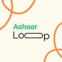
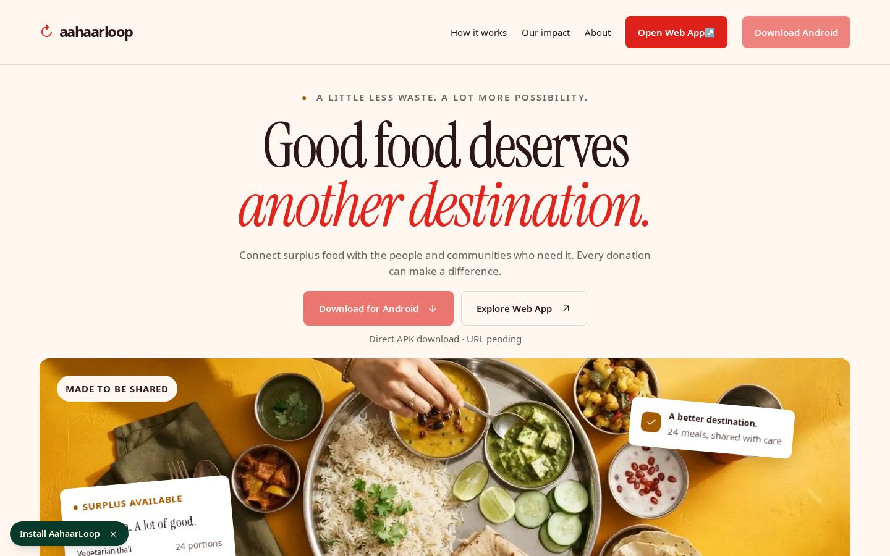
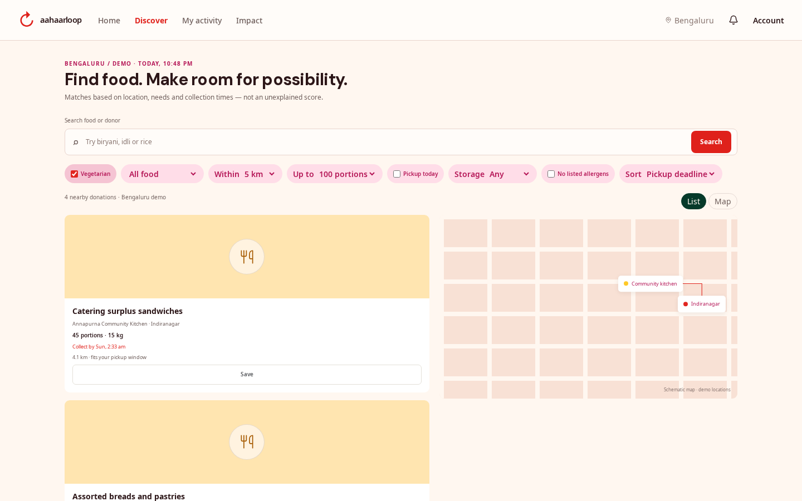
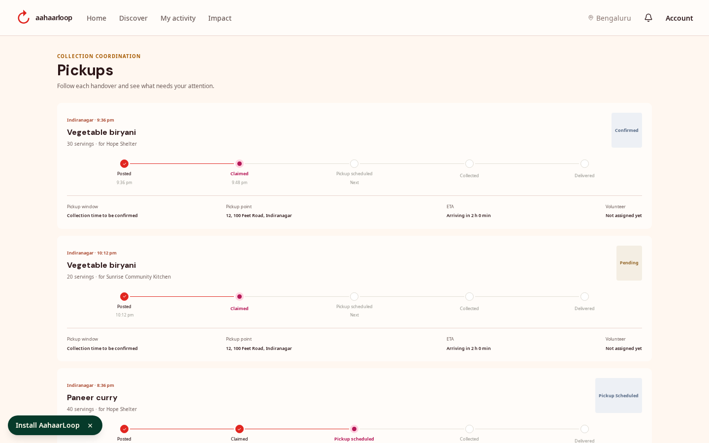
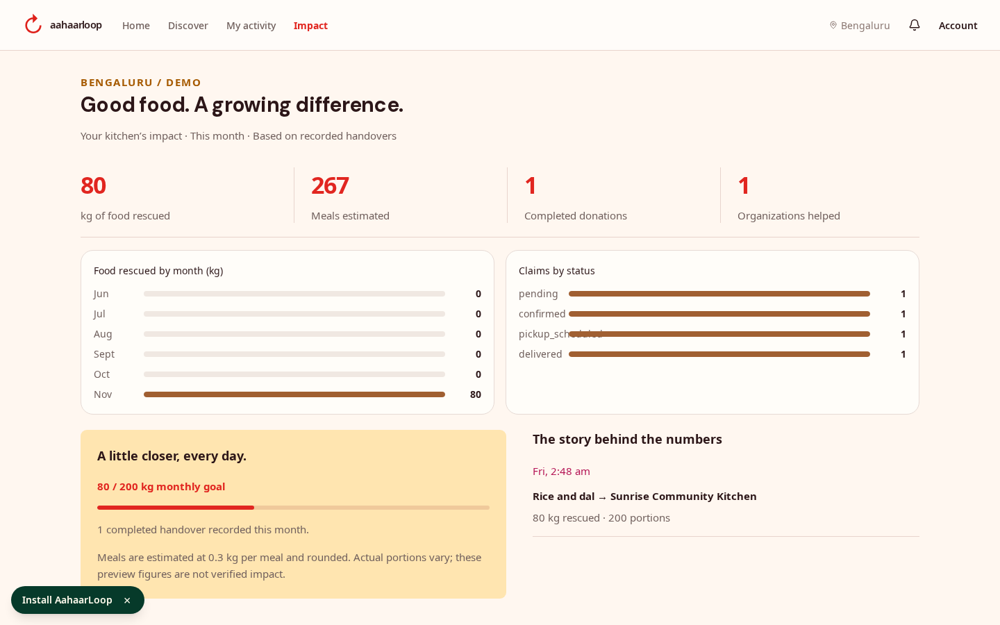
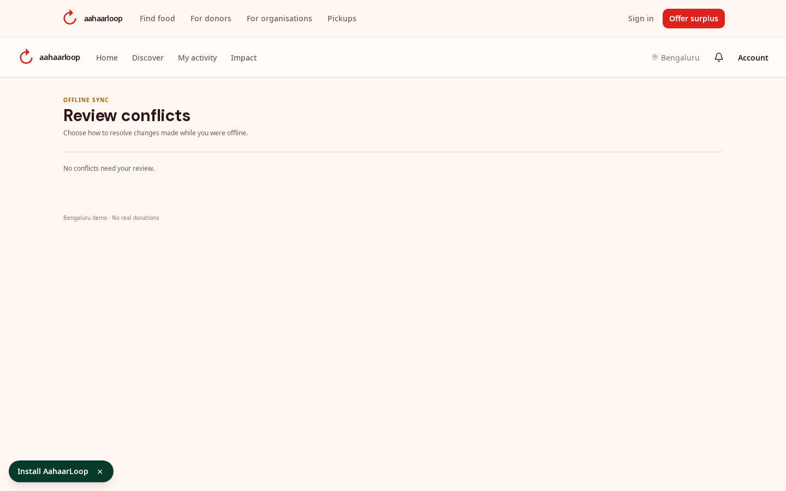

<div align="center">



# Aahaarloop

### Good food deserves another destination.

**Rescue surplus food before its deadline and get it to the people who can use it.**
Web · Android · one matching engine · one shared database.

<br />

[](https://nextjs.org)
[](https://react.dev)
[](https://www.typescriptlang.org)
[](https://tailwindcss.com)
[](https://neon.tech)
[](https://expo.dev)
<br />
[](#the-rules-we-never-break)
[](#offline-first)
[](#what-it-does)
[](#architecture)
[](.github/workflows/ci.yml)

<br />

```bash
git clone https://github.com/dinozaoro/aahaarloop.git && cd aahaarloop
pnpm install --frozen-lockfile
cp .env.example .env.local      # fill in the values from docs/development/environment.md
pnpm db:migrate && pnpm db:seed
pnpm dev
```

<br />



</div>

---

<div align="center">

## What it does

</div>

<table align="center">
  <tr>
    <td align="center" width="33%">
      <h3>Share surplus</h3>
      <sub>A kitchen lists what it cannot use before the deadline: portions, storage, allergens and a pickup point. A photo can be checked for authenticity by Sightengine.</sub>
    </td>
    <td align="center" width="33%">
      <h3>Find a destination</h3>
      <sub>Nearby organisations see a ranked, explainable shortlist based on location, needs, storage and urgency — never a mystery score.</sub>
    </td>
    <td align="center" width="33%">
      <h3>Deliver impact</h3>
      <sub>Volunteers accept a pickup, proof of delivery closes the loop, and the impact page turns handovers into kg rescued and estimated meals.</sub>
    </td>
  </tr>
  <tr>
    <td align="center">
      <h3>Partial claims</h3>
      <sub>A recipient takes only what they can collect. The rest stays available to the next kitchen and quantity never goes negative.</sub>
    </td>
    <td align="center">
      <h3>Hard deadlines first</h3>
      <sub>Food expiry (DLC) and pickup cutoff drive urgency. A missing deadline is never quietly treated as "low".</sub>
    </td>
    <td align="center">
      <h3>One backend, two clients</h3>
      <sub>The Expo app and the web app share the same matching package, domain rules and API. Actions queued offline replay with idempotency keys.</sub>
    </td>
  </tr>
</table>

---

<div align="center">

## _"Nothing rescued silently, nothing invented."_

</div>

_Aahaarloop_ closes the loop between a kitchen with too much food and a community kitchen that can use it. The matching is deterministic and explainable; the AI additions are **proposals**, never decisions.

<div align="center">

```
  Donor lists  ──►  Match ranks  ──►  Recipient claims  ──►  Volunteer picks up  ──►  Delivery proof
  DLC / DDM          location,          partial allowed,      mission accepted,        impact recorded
  + pickup cutoff    needs, storage     quantity released     timeline + ETA           kg + meals
```

</div>

---

<div align="center">

## The rules we never break

</div>

<table align="center">
  <tr>
    <td align="center" width="33%">
      <b>Hard deadlines are hard</b><br />
      <sub>An offer without a food-safety or pickup deadline is not given a reassuring urgency.</sub>
    </td>
    <td align="center" width="33%">
      <b>No silent data loss</b><br />
      <sub>Offline writes are queued with idempotency keys; conflicts are surfaced for a human decision.</sub>
    </td>
    <td align="center" width="33%">
      <b>Suggestions stay suggestions</b><br />
      <sub>AI labels and authenticity scores are signals a donor or moderator confirms, never automatic verdicts.</sub>
    </td>
  </tr>
</table>

---

<div align="center">

## A tour

</div>

<table>
  <tr>
    <td width="50%" valign="top">
      
      <p align="center"><b>Browse</b><br /><sub>Filter by food type, distance, storage and allergens. Switch between the list and the Leaflet map.</sub></p>
    </td>
    <td width="50%" valign="top">
      
      <p align="center"><b>Pickup tracking</b><br /><sub>Status timeline, pickup window, volunteer and a live ETA.</sub></p>
    </td>
  </tr>
  <tr>
    <td width="50%" valign="top">
      
      <p align="center"><b>Impact</b><br /><sub>Rescued kilograms by month, claim statuses and estimated meals.</sub></p>
    </td>
    <td width="50%" valign="top">
      
      <p align="center"><b>Conflict review</b><br /><sub>Merge, keep local or discard when an offline change disagrees with the server.</sub></p>
    </td>
  </tr>
</table>

---

<div align="center">

## Offline first

</div>

The field is not always connected. Donations, claims, drafts and session data live in an **IndexedDB** store on web and an **expo-sqlite** store on mobile. Mutations go through a persistent queue with retries and capped backoff; a conflict becomes a record a human resolves. A service worker precaches the shell and serves assets cache-first.

<sub>`GET /api/health` reports both the database and the branch AI Gateway. AI Gateway is optional: when no credits are configured it reports `available:false` and the rest of the product keeps working.</sub>

---

<div align="center">

## Architecture

</div>

| Layer                       | What lives here                                                                 |
| --------------------------- | ------------------------------------------------------------------------------- |
| `apps/web`                  | Next.js 16 App Router, route handlers, admin, PWA, service worker, Leaflet map  |
| `apps/mobile`               | Expo 58 / React Native app, SQLite outbox, camera capture, missions, QR install |
| `packages/matching`         | Pure, deterministic urgency and ranking rules                                   |
| `packages/shared`           | Vocabulary, Zod schemas, lifecycle and date rules                               |
| `packages/database`         | Drizzle schema, migrations, seed and demo data                                  |
| `packages/food-recognition` | Provider-agnostic AI suggestions and Sightengine authenticity signal            |

**Services:** Lakebase Postgres (pooled for runtime, direct for migrations), Auth.js with Google, Cloudinary sign uploads, Sightengine for image authenticity, optional Neon AI Gateway. No secret is prefixed with `NEXT_PUBLIC_`.

---

<div align="center">

## Checks and demo

</div>

```bash
pnpm lint && pnpm typecheck && pnpm test && npm run build
pnpm db:check                 # read-only Neon smoke test
curl https://aahaarloop.vercel.app/api/health
```

The demo script is in [`docs/demo-script.md`](./docs/demo-script.md) and the final checklist in [`docs/demo-checklist.md`](./docs/demo-checklist.md). The Android QR is [`apps/mobile/assets/install-qr.png`](./apps/mobile/assets/install-qr.png).

<sub>Every commit carries the two developer co-author trailers; one branch and one PR per issue.</sub>
