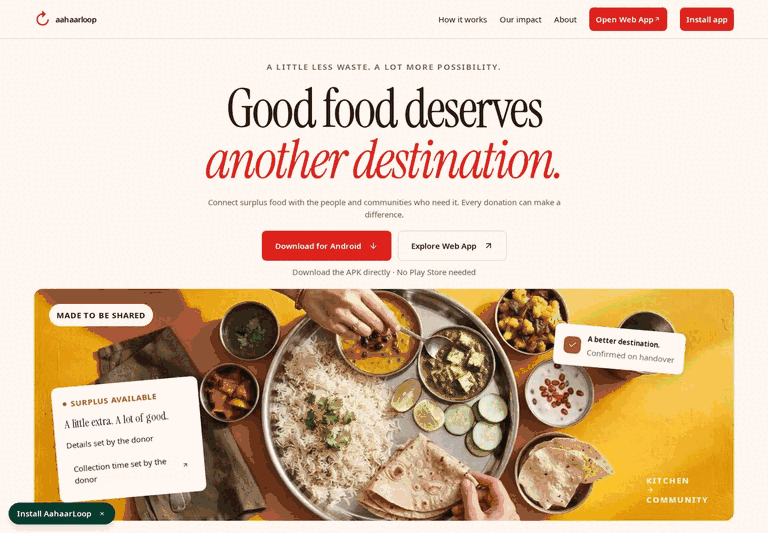
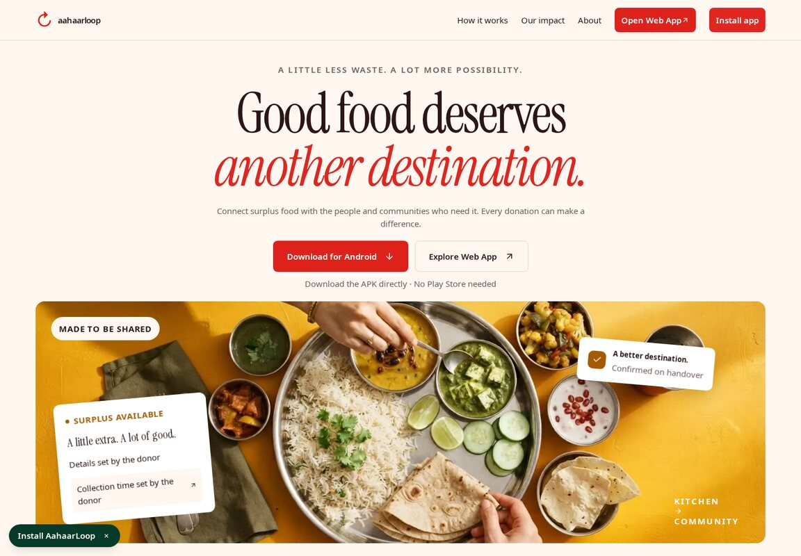
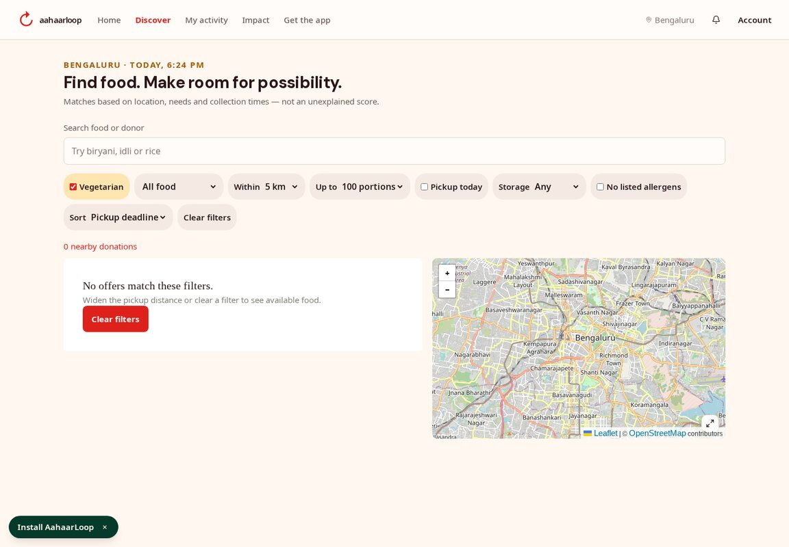
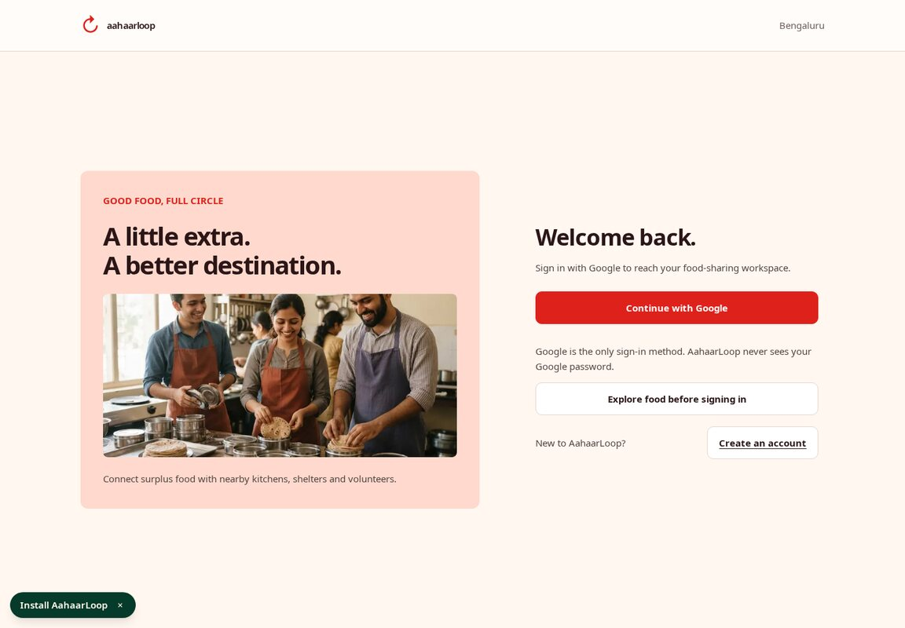
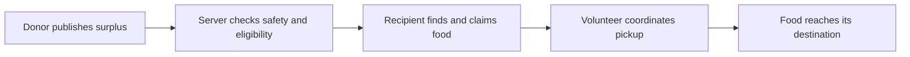

<div align="center">
  

  <h1>Aahaarloop</h1>
  <p><strong>Good food deserves another destination.</strong></p>
  <p>A shared food-rescue workspace connecting surplus food with nearby kitchens, shelters and volunteers in Bengaluru.</p>

  <p>
    <a href="https://aahaarloop.vercel.app/">Open the web app</a> ·
    <a href="https://github.com/dinozaoro/aahaarloop/releases">Android releases</a> ·
    <a href="docs/architecture.md">Architecture</a>
  </p>

  <p>
    
    
    
    
    
  </p>
</div>

## Why Aahaarloop

Good food is often discarded because it cannot reach the people who need it
before its pickup deadline. Aahaarloop helps donors publish surplus, recipient
organizations find food that fits their needs, and volunteers coordinate
collection. Matching is explainable: distance, deadlines, storage, quantity and
recipient needs all matter.

The project is built as a web and mobile monorepo. The Next.js server owns
authentication, authorization and database access; the Expo app uses the same
HTTP API and shared TypeScript rules.

## See it

|                                                        Home                                                        |                                                     Browse                                                      |
| :----------------------------------------------------------------------------------------------------------------: | :-------------------------------------------------------------------------------------------------------------: |
|  |  |

|                                                  Sign in                                                  |
| :-------------------------------------------------------------------------------------------------------: |
|  |

_Screens captured from the live web app. Browse listings depend on the selected
filters and the data available in the configured database._

## Product flow



Donations move through explicit lifecycle states, and claims are protected
against duplicate submissions. Matching rules are deterministic and shared
between platforms; the score is accompanied by hard-filter decisions and
reasons.

## Technology

| Area             | Technologies                                             | Responsibility                                                                     |
| ---------------- | -------------------------------------------------------- | ---------------------------------------------------------------------------------- |
| Web              | Next.js App Router, React, TypeScript, Tailwind CSS      | Public pages, dashboards, browse, server actions and API routes                    |
| Mobile           | Expo, React Native, Expo Router, TypeScript              | Android-first field workflows and API client                                       |
| Identity         | Auth.js, Google OAuth                                    | Sign-in and session management                                                     |
| Data             | Neon PostgreSQL, Drizzle ORM, `pg`                       | Persistent application data, schema and migrations                                 |
| Shared domain    | `@aahaarloop/shared`, `@aahaarloop/matching`             | Environment validation, types, urgency and matching rules                          |
| Food recognition | `@aahaarloop/food-recognition`                           | Provider-neutral analysis and confirmation flow; provider credentials are optional |
| UI               | Radix UI, Lucide, Papicons, Sonner                       | Accessible primitives, icons and notifications                                     |
| Maps             | Leaflet, React Leaflet, OpenStreetMap tiles              | Location context in food discovery                                                 |
| Tooling          | pnpm workspaces, Turborepo, ESLint, Prettier, TypeScript | Dependency management, task orchestration and quality checks                       |
| Delivery         | GitHub Actions, Vercel, EAS Build, GitHub Releases       | CI, web deployment and Android preview builds                                      |

The dependency graph is managed with pnpm. Direct dependencies belong in the
workspace package that imports them; `pnpm-lock.yaml` records the resolved
versions. Shared business rules belong in `packages/`, not in one platform's
UI. The codebase includes interfaces for integrations that may need deployment
configuration; an interface alone does not mean a live provider is enabled.

## Repository map

```text
apps/
  web/                    Next.js web app, API routes and server actions
  mobile/                 Expo app
packages/
  config/                 Shared TypeScript and lint configuration
  database/               Drizzle schema, migrations and demo seed
  food-recognition/       Food analysis and confirmation flows
  matching/               Pure urgency and matching rules
  shared/                 Shared types, constants and environment schemas
docs/                     Product, architecture, setup and operator guides
scripts/                  Repository checks and release helpers
```

## Run locally

### Requirements

- Node.js **22.18 or newer** (`.nvmrc`)
- Corepack and pnpm **9.15.0**
- A Neon/PostgreSQL development database for database-backed web flows
- Android Studio or an Android device for native mobile testing

### Install and configure

```bash
git clone https://github.com/dinozaoro/aahaarloop.git
cd aahaarloop
corepack enable
pnpm install
cp .env.example .env.local
```

Ask a project maintainer for development-only values, then set the required
variables in `.env.local`. At minimum, the web server needs `DATABASE_URL`,
`NEXT_PUBLIC_APP_URL`, `AUTH_SECRET`, `AUTH_GOOGLE_ID` and
`AUTH_GOOGLE_SECRET`. Set `DIRECT_URL` when running migrations. Never put
production credentials in local files or commit secrets.

For mobile, configure its API base URL separately:

```bash
cp apps/mobile/.env.example apps/mobile/.env.local
# Set EXPO_PUBLIC_API_URL to the web API URL
```

### Start the apps

```bash
pnpm dev       # Web and mobile development servers
pnpm web       # Web only, usually http://localhost:3000
pnpm mobile    # Expo only
```

To prepare a development database, review the target connection string first,
then run:

```bash
pnpm db:check
pnpm db:migrate
```

`db:migrate` applies pending migrations and ensures the deterministic demo
seed. `pnpm db:seed` can replay the seed without overwriting existing rows.
`pnpm db:reset` is destructive, requires `ALLOW_DB_RESET=true`, and must never
be run against production. See [database demo data](docs/database/demo-data.md)
and [environment setup](docs/development/environment.md).

## Useful commands

| Command                                       | Purpose                                               |
| --------------------------------------------- | ----------------------------------------------------- |
| `pnpm build`                                  | Build workspace packages and the web app              |
| `pnpm lint`                                   | Lint all workspaces                                   |
| `pnpm typecheck`                              | Type-check all workspaces                             |
| `pnpm test`                                   | Run package tests and repository boundary/link checks |
| `pnpm format`                                 | Format files with Prettier                            |
| `pnpm format:check`                           | Check formatting without modifying files              |
| `pnpm db:check`                               | Test the database connection with a read-only query   |
| `pnpm --filter @aahaarloop/database generate` | Generate a migration from schema changes              |
| `pnpm --filter @aahaarloop/mobile android`    | Start Expo for an Android device/emulator             |

CI runs install, lint, type-check, tests and a web production build. It also
type-checks the mobile app. See [CI details](docs/ci.md).

## Contributing

Contributions are welcome. Before opening a pull request:

1. Create a focused branch using `<type>/<short-kebab-case-description>`:
   `feat/recipient-filters`, `fix/claim-quantity`, or `docs/local-setup`.
2. Keep changes scoped to one issue and add a focused test when behavior
   changes.
3. Run the relevant checks; for a full local pass, use `pnpm lint`,
   `pnpm typecheck`, `pnpm test` and `pnpm format:check`.
4. Open a pull request against `main` and describe the behavior, tests and any
   database or environment changes.

Use English Conventional Commit messages:

```text
docs(readme): improve project onboarding

Co-authored-by: ItokianaRAKT <itokianarakt@gmail.com>
Co-authored-by: fatratra-png <nyfatratrar@gmail.com>
```

Every commit must include exactly those two co-author trailers. Do not add an
AI or other external tool as an author or co-author. Full branch, commit and
pull request rules are in [`AGENTS.md`](AGENTS.md).

## Guides

| Topic                             | Guide                                                                       |
| --------------------------------- | --------------------------------------------------------------------------- |
| System overview and data flow     | [Architecture](docs/architecture.md)                                        |
| Product behavior and domain terms | [Product specification](docs/product-spec.md)                               |
| Matching and urgency              | [Matching algorithms](docs/matching-algorithms.md)                          |
| Environment variables and setup   | [Environment configuration](docs/development/environment.md)                |
| Database schema and demo seed     | [Schema](docs/database/schema.md) · [Demo data](docs/database/demo-data.md) |
| Authentication and roles          | [Authentication](docs/authentication.md) · [RBAC](docs/rbac.md)             |
| API behavior                      | [API foundation](docs/api-foundation.md)                                    |
| Release and install               | [APK releases](docs/apk-release.md) · [EAS builds](docs/eas-build.md)       |
| Accessibility and security        | [Accessibility](docs/accessibility.md) · [Security](docs/security.md)       |
| Architecture decisions            | [ADR index](docs/adr/README.md)                                             |

## Demo

Demo data uses fictional accounts and organizations. The seed includes example
donations, recipient needs, claims and a volunteer pickup task; demo sign-in
still requires the configured Google OAuth provider. Follow the
[12-minute walkthrough](docs/demo-script.md) and [demo checklist](docs/demo-checklist.md).

---

<div align="center">
  <sub>Built to give good food another destination. Bengaluru, India.</sub>
</div>
