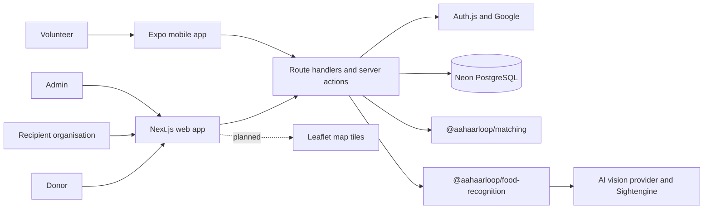
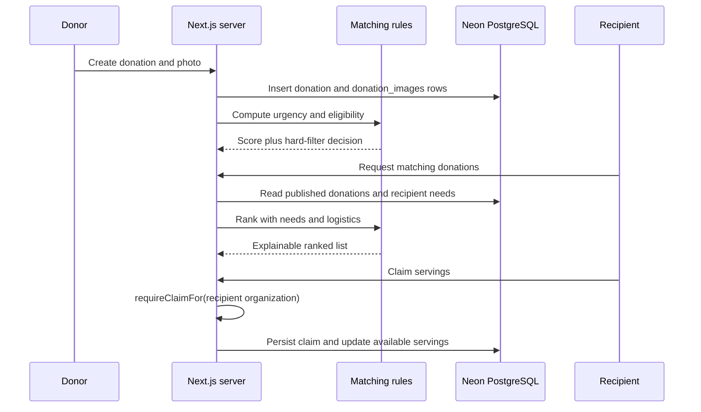
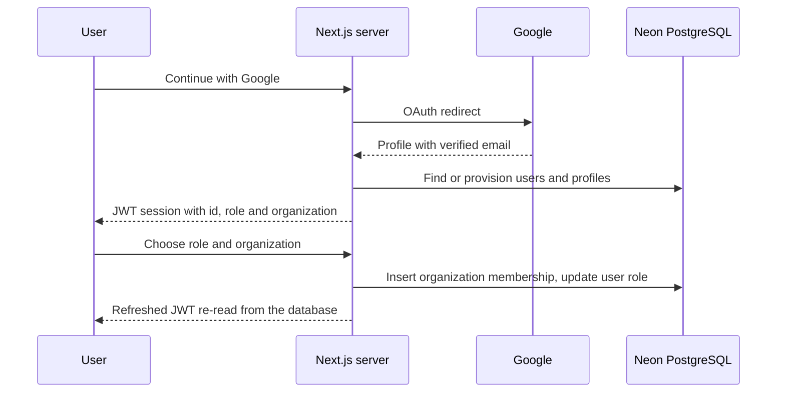
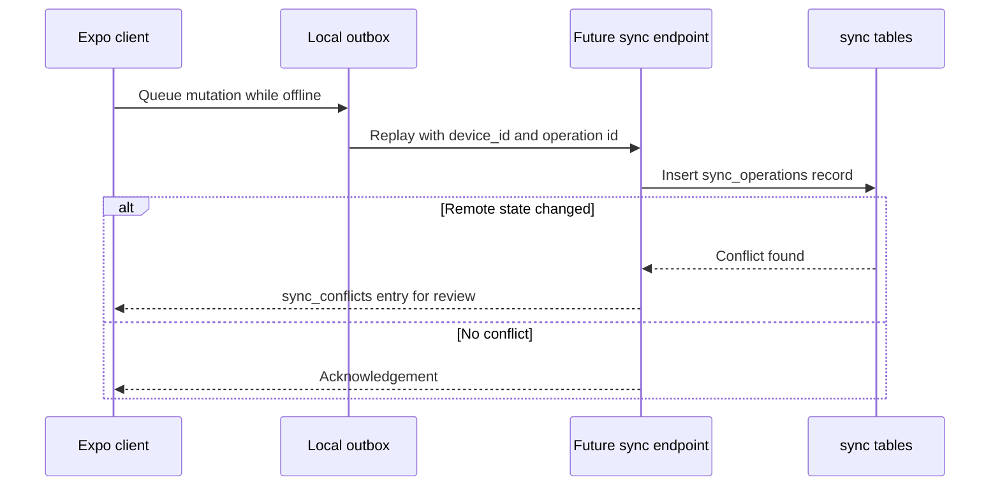
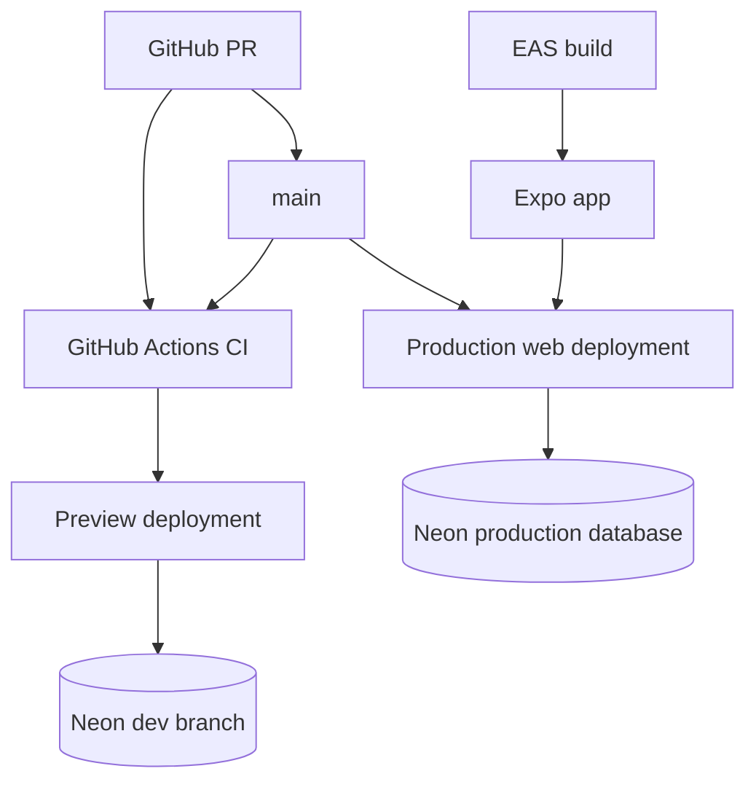

# Architecture

This is the reference for system boundaries and data flow. It describes the
code that exists in this repository and marks work that is only designed. See
the [ADR index](adr/README.md) for the decisions behind each choice.

## Status

- **Implemented:** pnpm/Turborepo workspace, Next.js web shell, Auth.js sign-in
  and onboarding, server-side RBAC, Drizzle schema and migrations, shared
  matching rules, food-recognition interfaces and GitHub Actions CI.
- **Designed, not integrated:** map tiles (Leaflet), image uploads
  (Cloudinary), live AI credentials, mobile offline sync and deployment
  pipelines. Schema columns and interfaces exist for these, but no live service
  is configured here.

## System context

Only the web app currently talks to the database. The Expo app declares
`EXPO_PUBLIC_API_URL` for future API calls; it has no data screens yet.

## Workspaces

| Workspace                   | Role                                                                   |
| --------------------------- | ---------------------------------------------------------------------- |
| `apps/web`                  | Next.js App Router UI, route handlers, server actions and auth guards  |
| `apps/mobile`               | Expo Router app, configured with shared TypeScript and env parsing     |
| `packages/shared`           | Platform-neutral constants, types and env schemas                      |
| `packages/matching`         | Deterministic urgency and matching rules (pure functions)              |
| `packages/database`         | Drizzle schema, relations, migrations, seed and admin bootstrap        |
| `packages/food-recognition` | Provider-neutral analysis, confirmation, authenticity and publish flow |
| `packages/config`           | Shared TypeScript and ESLint configuration                             |

Apps never import another platform's UI. Platform-neutral logic lives in the
packages so web and mobile can reuse it; see `scripts/workspace.test.mjs`.

## Donation to claim flow

The matching package never mutates state: it receives donor, recipient and
logistics inputs and returns a decision with reasons. The prototype web UI
still reads a seeded in-memory store in `apps/web/src/lib/data/store.ts`; the
persistent tables and claim lifecycle are defined in `packages/database`.

## Authentication and authorization

Session claims identify the actor, but privileged handlers re-check membership
and ownership on the server. Details and helper names are in
[authentication](authentication.md) and [RBAC](rbac.md).

## Matching

Urgency, hard filters, weights and the worked example live in
[matching algorithms](matching-algorithms.md); domain terms are in the
[product specification](product-spec.md). The same pure package is intended to
drive both web lists and mobile notifications so explanations stay consistent.

## Offline sync (designed)

`device_sessions`, `sync_operations` and `sync_conflicts` already exist in the
schema, but no sync endpoint, local outbox or conflict resolver is implemented.
Idempotency keys and server-side RBAC must be part of the endpoint before it is
exposed.

## Deployment

CI details are in [CI](ci.md) and variables in
[environment configuration](development/environment.md). Each environment owns
its `AUTH_SECRET`, Google OAuth client and database strings; preview databases
must never be production data. The workflow uses no secrets itself. The EAS
pipeline is not configured yet.

## Decisions

- [0001 Next.js App Router](adr/0001-nextjs-app-router.md)
- [0002 Drizzle ORM](adr/0002-drizzle-orm.md)
- [0003 Neon PostgreSQL](adr/0003-neon-postgresql.md)
- [0004 Auth.js](adr/0004-authjs.md)
- [0005 Leaflet](adr/0005-leaflet.md)
- [0006 Expo](adr/0006-expo.md)
- [0007 pnpm and Turborepo](adr/0007-pnpm-turborepo.md)
- [0008 Cloudinary](adr/0008-cloudinary.md)
- [0009 AI providers](adr/0009-ai-providers.md)
